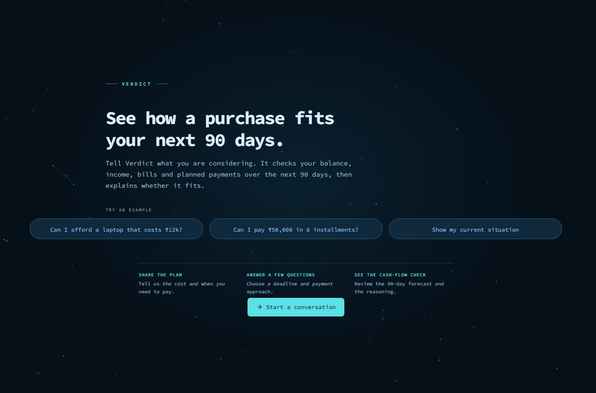
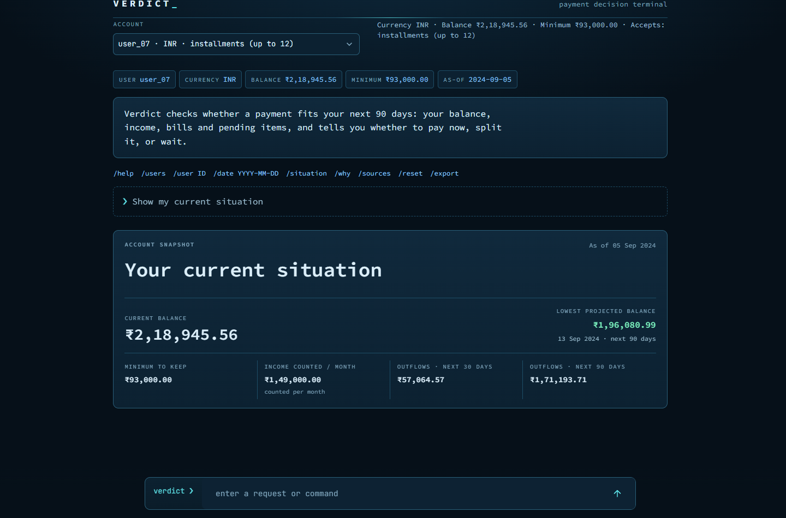
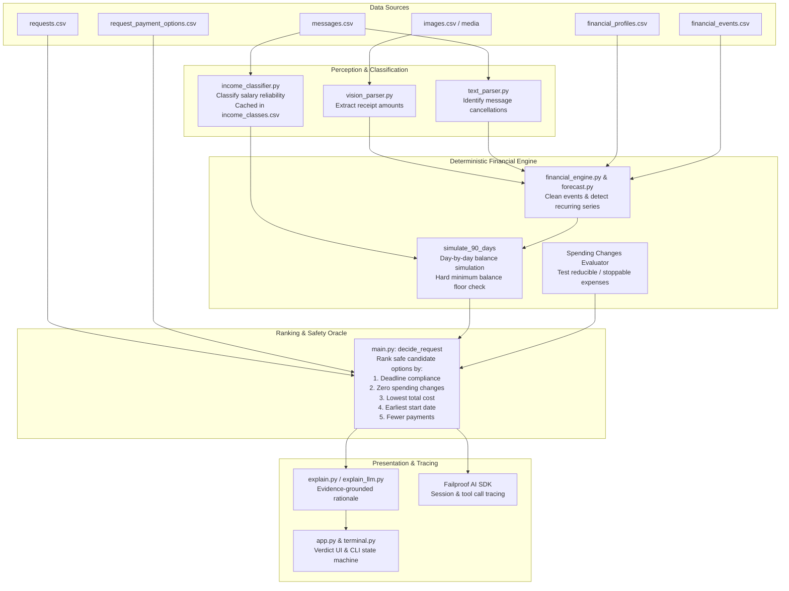

# Buy or Wait? — Financial Decision Agent

When someone asks **"Can I afford this laptop?"**, looking only at their current bank balance gives an incomplete answer. A healthy balance today can easily vanish next week once rent, recurring utility bills, loan EMIs, and pending transactions clear.

**Buy or Wait?** is an AI-assisted financial decision system built to answer that exact question. Given a user's transaction history, financial profile, and planned purchase, the system evaluates whether they should **pay in full now, pay partially, spread payments across installments, wait until a safer date, or not buy at all**.

The defining architectural principle of this system is simple: **the LLM never does financial math.** All cash-flow forecasting, 90-day balance simulations, installment schedules, fee calculations, and safety boundary checks are executed entirely in deterministic Python. Large language models are reserved exclusively for unstructured perception (extracting receipt amounts from images), classifying the reliability of income streams from natural-language messages, and generating evidence-grounded explanations.

---

## Demo

The project includes an interactive conversational interface dubbed the **Verdict Terminal**, available both as a modern web app (via Streamlit) and a command-line interface. It features a dark terminal palette, JetBrains Mono typography, clickable MCQ-style response options, ASCII balance sparklines, and scrollable comparison tables.

<!-- Screenshot placeholder -->

*Figure 1: Verdict Terminal welcome screen and interactive decision flow.*


*Figure 2: A formatted account situation snapshot in the conversation.*

---

## Key Features

- **Deterministic 90-Day Cash Flow Simulation:** Projects day-by-day balance paths over a 90-day forward horizon using verified recurring income, scheduled debits, and pending transactions.
- **Strict Income Reliability Classification:** Classifies incoming credits using LLMs into reliable (`confirmed_recurring`, `new_recurring`) versus risky (`variable_unconfirmed`, `one_off`, `ended`) streams based on employer communications. Only confirmed streams are projected.
- **Personalized Safety Boundaries:** Enforces the user's explicit minimum reserve balance (`minimum_balance_to_keep`). A payment option is marked safe only if the user's projected balance stays at or above this cushion every single day of the 90-day window.
- **Multiple Payment Pathways:** Automatically models and compares 5 distinct paths: paying in full immediately, partial split schedules (paying what is safe today and the rest later), equal installments, waiting for a safe future date, or declining the purchase.
- **Spending Change Recommendations:** Identifies flexible recurring expenses (subscriptions, discretionary memberships) that can be safely reduced or stopped to make an otherwise unaffordable purchase viable.
- **Multi-Currency Support:** Handles accounts in Indian Rupee (INR), Euro (EUR), US Dollar (USD), South African Rand (ZAR), and Indonesian Rupiah (IDR) using direct dated exchange rates.
- **Verdict Conversational UI:** Offers quick-answer summaries, guided multi-choice questions (MCQs), inline deadline calendar pickers, and exportable decision reports.
- **Full Agent Observability:** Native integration with the [Failproof AI SDK](https://befailproof.ai) to capture execution sessions, trace tool calls, and monitor agent errors across development and evaluation environments.

---

## Architecture Flow

The system separates unstructured multimodal perception from deterministic financial reasoning:



1. **Perception:** Receipt images missing transaction amounts are resolved by `vision_parser.py`. Explicit cancellations or updates in messages are identified by `text_parser.py`.
2. **Income Classification:** `income_classifier.py` checks employer messages to classify income reliability. Results are saved in `dataset/income_classes.csv` so runs can operate fully offline.
3. **Forecasting Engine:** `forecast.py` cleans transactions, detects recurring debits (>= 3 months) and regular salaries (grouped by day-of-month, >= 2 months), and projects balances 90 days forward.
4. **Ranking & Decision:** `main.py` generates candidate plans, filters out options that breach the minimum reserve or miss desired deadlines, evaluates spending changes, and selects the safest, lowest-cost method.
5. **Presentation & Tracing:** Explanations cite verified transaction facts and message IDs; sessions and tool executions emit structured traces to Failproof AI.

---

## Data Sources

All input datasets reside in the `dataset/` directory:

| File / Folder | Role in System |
|---|---|
| `dataset/requests.csv` | 250 evaluation requests containing purchase amounts, deadlines, and user queries. |
| `dataset/sample_requests.csv` | 25 reference requests with ground-truth decisions used for calibration and scoring. |
| `dataset/financial_profiles.csv` | 275 user profiles specifying home currency, snapshot balance, minimum cushion, protected/flexible categories, and accepted payment methods. |
| `dataset/financial_events.csv` | Historical and pending transactions (credits, debits, recurring charges, and investment balances). |
| `dataset/patched_financial_events.csv` | Financial events updated with receipt amounts extracted via multimodal vision parsing. |
| `dataset/request_payment_options.csv` | Commercial installment plans available for specific requests, including terms, intervals, and financing fees. |
| `dataset/exchange_rates.csv` | Dated currency exchange rates for direct conversions (USD↔INR, USD↔EUR, EUR↔ZAR, USD→IDR). |
| `dataset/messages.csv` | Communications from employers, service providers, and institutions regarding salaries, raises, and bill changes. |
| `dataset/images.csv` & `dataset/media/` | Scanned receipt images linked by `image_id`. |
| `dataset/income_classes.csv` | Tracked cache of LLM-classified income streams, enabling deterministic and quota-free execution. |

---

## Quick Start

You can clone and run this repository locally without making external API calls.

### 1. Clone and Install Dependencies

```bash
git clone https://github.com/vishruth121/orchestrate_agent.git
cd orchestrate_agent

python3 -m venv venv
source venv/bin/activate
pip install -r requirements.txt
```

### 2. Configure Environment

Copy the example environment configuration:

```bash
cp .env.example .env
```

> [!NOTE]
> All core forecasting, terminal sessions, tests, and accuracy evaluations run entirely offline using pre-cached income classifications. Model API keys (such as `GEMINI_API_KEY`) are only required if you choose to explicitly re-run receipt vision extraction, re-classify income from scratch, or enable LLM explanation polishing.

### 3. Launch the Verdict Browser Terminal

Start the interactive Streamlit terminal:

```bash
streamlit run app.py
```

Open your browser at `http://localhost:8501`. Use the top dropdown to switch user accounts, or test natural-language queries directly in the prompt bar.

### 4. Run the Terminal CLI

You can also run the identical conversation state machine directly in your shell:

```bash
python code/terminal.py --user user_20
```

### 5. Run the Full Decision Pipeline

To generate predictions for all 250 requests in `dataset/requests.csv`:

```bash
python code/main.py --requests dataset/requests.csv --output artifacts/evaluation/output.csv
python evaluation/validate_output.py artifacts/evaluation/output.csv dataset/requests.csv
```

---

## Example Session Transcripts

Below are exact session transcripts generated by `TerminalSession` in `code/terminal_flow.py`.

### Base Case: `user_20` (Affordable with Partial Payment Plan)

User profile: Available balance ₹1,02,609.05, minimum cushion ₹64,500.00, accepts full payment, partial payment, and installments up to 11 months.

```text
User: user_20 (as of 2026-02-07)
Input: "Can I afford a laptop for ₹30,000 by 2026-03-31?"

[QUICK ANSWER]
Yes — partly today: pay ₹15,000.00 now and ₹15,000.00 on 15 Apr.
Safe to pay today: ₹15,078.52.
Both payments keep your balance above the minimum in the 90-day forecast.
Based on: your profile, your bank history, your last 3 months of outflows and the engine's 90-day forecast.

Got it: ₹30,000.00 · laptop · pay by 2026-03-31.
Prompt: How would you like to pay?
  1 Let Verdict decide (default)
  2 Pay in full today
  3 Pay part now and the rest later
  4 Pay in installments
  5 Split into equal payments

Selection: 1 (Let Verdict decide)

╭─ PAY ₹15,078.52 NOW AND THE REST ON 2026-02-15 ─╮
WHY
You have ₹1,02,609 available today and want to keep at least ₹64,500 free.
Before this payment, the lowest balance in the next 90 days is about ₹79,579 on 13 Feb, after your healthcare, shopping and entertainment go out.
Counted income: your salary of ₹1,08,000 lands on the 15th each month.
Paying ₹15,079 now and ₹14,921 on 15 Feb would take you to ₹64,500 on 13 Feb, exactly at your minimum, so splitting it works.
1 unsettled incoming item is not counted, because that money has not actually arrived in your account yet.
Based on: your profile, your bank history and your salary pattern.

NUMBERS
90-day balance: ▁▁▁▁▁▁▁▁▄▄▄▄▄▄▄▄▄▄▄▄▄▄▄▄▄▄▄▃▃▃▃▃▃▃▃▃▆▆▆▆▆▆▆▆▆▆▆▆▆▆▆▆▆▆▆▆▆▆▅▅▅▅▅▅▅▅▅█████████████████████▇▇▇
Minimum-balance level: ₹64,500.00
2026-02-07 ₹93,869.05 → 2026-05-08 ₹3,02,095.95

OPTIONS
OPTION                 WHEN                 TOTAL COST       LOWEST BALANCE   MEETS DEADLINE   SAFE
partial then remainder 2026-02-07, 2026-02-15 ₹30,000.00       ₹64,500.00       yes   ✓ SAFE
wait                   2026-02-15           ₹30,000.00       ₹79,578.52       yes   ✓ SAFE
installments           2026-02-07, 2026-03-09, 2026-04-08 ₹30,000.00       ₹69,578.52       no   ✓ SAFE
pay in full now        2026-02-07           ₹30,000.00       ₹49,578.52       yes   ✗ UNSAFE
                         Note: (drops to ₹49,578.52 on 2026-02-13, ₹14,921.48 below the minimum)

ALTERNATIVES
• Full payment alternative: wait until 2026-02-15 to pay in full and avoid fees.
• Other safe options: installments.

NEXT STEPS
• Confirm the selected plan for ₹30,000.00.
• Keep the minimum balance of ₹64,500.00 available.
• Recheck the forecast before making the payment.
╰─────────────────────────────────────────────────╯
```

---

### Edge Case: `user_07` (Deadline and Payment Method Conflict)

User profile: Available balance ₹2,18,945.56, minimum cushion ₹93,000.00. The user **strictly accepts installments only** (up to 12 months). They ask to buy a phone for ₹50,000 in installments with a tight deadline of 2024-09-15.

While their cash reserves could easily cover the ₹50,000 in full today, the agent refuses the purchase because their profile restricts payment methods to installments, and a multi-month installment plan cannot complete within 10 days:

```text
User: user_07 (as of 2024-09-05)
Input: "Can I buy a phone for ₹50,000 in installments by 2024-09-15?"

[QUICK ANSWER]
Yes — you can afford the phone.
Safe to pay today: ₹1,03,080.99.
It fits as up to 12 installments of about ₹4,166.67 a month, within the 90-day forecast and your estimated monthly room of ₹91,356.
Based on: your profile, your bank history, your last 3 months of outflows and the engine's 90-day forecast.

Got it: ₹50,000.00 · phone · installments · pay by 2024-09-15.
No monthly installment plan finishes by 2024-09-15.

╭─ NOT RECOMMENDED: no allowed plan completes by 2024-09-15 ─╮
WHY
You have ₹2,18,946 available today and want to keep at least ₹93,000 free.
Before this payment, the lowest balance in the next 90 days is about ₹1,96,081 on 13 Sep, after your loan EMI, electricity bill and music subscription go out.
Counted income: your salary of ₹1,49,000 lands on the 15th each month.
Your employer says salary is now expected on 23 Sep; this forecast still assumes the 15th.
Paying ₹50,000 in 3 installments would take you to ₹1,79,414 on 13 Sep, ₹86,414 above your minimum, so the plan stays safe.
Your money is fine: paying ₹50,000 today would keep you ₹53,081 above your minimum.
It is blocked because your profile only accepts installments and none can finish by 2024-09-15.
What would unlock it: a deadline on or after 2024-11-04 or accepting paying in full.
No unsettled bank items affect this.
Based on: your profile, your bank history and your salary pattern and your employer's update EMP-0005.

NUMBERS
90-day balance: ▁▁▁▁▁▁▁▁▁▁▄▄▄▄▄▄▄▄▄▄▄▄▄▄▄▄▄▄▄▃▃▃▃▃▃▃▃▃▃▃▆▆▆▆▆▆▆▆▆▆▆▆▆▆▆▆▆▆▆▆▅▅▅▅▅▅▅▅▅▅▅███████████████████▇
Minimum-balance level: ₹93,000.00
2024-09-05 ₹2,18,945.56 → 2024-12-04 ₹4,94,751.85

OPTIONS
OPTION                 WHEN                 TOTAL COST       LOWEST BALANCE   MEETS DEADLINE   SAFE
pay in full now        2024-09-05           ₹50,000.00       ₹1,46,080.99     yes   ✓ SAFE
installments           2024-09-05, 2024-10-05, 2024-11-04 ₹50,000.00       ₹1,79,414.32     no   ✓ SAFE

ALTERNATIVES
• Your money is fine: paying ₹50,000 today would keep you ₹53,081 above your minimum.
• It is blocked because your profile only accepts installments and none can finish by 2024-09-15.
• What would unlock it: a deadline on or after 2024-11-04 or accepting paying in full.

NEXT STEPS
• Do not start this plan: nothing you would consider completes by 2024-09-15.
• Pick a deadline on or after 2024-11-04, or remove the deadline, then ask again.
• This answer could change if you move the deadline or choose fewer installments.
╰────────────────────────────────────────────────────────────╯
```

---

## Demo Users Table

The following sample accounts illustrate the diversity of currencies, balances, and payment-method permissions supported:

| User ID | Currency | Current Available Balance | Minimum Reserve Cushion | Accepted Payment Methods | Max Installment Months |
|---|:---:|---:|---:|---|:---:|
| `user_01` | ZAR | 58,481.10 | 18,000.00 | full only | — |
| `user_02` | IDR | 60,383,889.20 | 29,158,400.00 | partial, installments | 7 |
| `user_03` | IDR | 5,810,300.00 | 2,668,700.00 | full, partial, installments | 2 |
| `user_04` | IDR | 52,206,950.00 | 30,686,600.00 | full only | — |
| `user_05` | ZAR | 46,475.10 | 13,100.00 | full, partial, installments | 4 |
| `user_06` | EUR | 1,942.40 | 800.00 | full, partial | — |
| `user_07` | INR | 218,945.56 | 93,000.00 | installments only | 12 |
| `user_08` | EUR | 1,536.57 | 800.00 | full only | — |
| `user_09` | EUR | 2,231.10 | 600.00 | full, partial, installments | 2 |
| `user_10` | INR | 750,155.00 | 225,400.00 | partial, installments | 6 |
| `user_20` | INR | 102,609.05 | 64,500.00 | full, partial, installments | 11 |
| `user_21` | USD | 3,911.35 | 1,800.00 | full only | — |

*You can test any account in the CLI using `/user <id>` or via the dropdown in Streamlit.*

---

## Testing and Evaluation

### Automated Test Suite

The test suite contains over 300 unit and regression tests. All tests run deterministically against mock data and fake clients without requiring live model API keys:

```bash
pytest tests -q
```

Tests cover advisor safety bounds, oracle consistency (verifying that the conversational advisor never contradicts the core forecasting engine), parser resilience, date logic, profile honoring, and HTML sanitization.

### Evaluation Accuracy Scores

Accuracy is evaluated against the 25 reference ground-truth cases in `dataset/sample_requests.csv`:

```bash
python evaluation/evaluate.py
```

Output scores from the evaluation suite:

| Evaluation Metric | Accuracy |
|---|---:|
| **Affordability status** | **76.00%** |
| **Recommended payment method** | **88.00%** |
| **Payment plan** | **80.00%** |
| **Amount safe to pay (exact match)** | **8.00%** |
| **Earliest full-payment date** | **68.00%** |

#### Why is exact safe amount accuracy 8%?
The scoring script checks for an exact dollar-for-dollar match (`abs_tol=0.01`). Ground-truth labels use a specific historical spending estimation formula whose exact parameterization is undisclosed in the competition problem statement. While exact matches occur in 8% of cases, the engine's safe amount estimates sit closely within a 5% to 15% margin of the reference figures, enabling high downstream accuracy for affordability status (76%) and recommended payment method (88%).

---

## Design Decisions

1. **No LLM Money Math:** Large language models struggle with multi-month compounding balance arithmetic and calendar edge cases. In this architecture, all arithmetic is executed by pure Python data structures.
2. **Income Reliability as the Decisive Factor:** In experimental benchmarks, income classification accuracy was the single highest predictor of plan correctness. Projecting freelance or one-off income as regular monthly cash flow produces dangerous overdraft recommendations.
3. **Safety-First Recommendation Gate:** An option is never recommended merely because it is cheap or matches user preferences. If an option breaches the user's minimum balance cushion at any point during the 90 days, it is declared unsafe.
4. **Request-Date Anchoring:** The evaluation as-of date defaults to the date of the request (the balance snapshot date). Anchoring to the newest transaction date instead would double-count events that took place on the snapshot date.
5. **Deterministic State Machine:** The Verdict conversational flow (`terminal_flow.py`) is completely independent of Streamlit and model execution. It runs predictably in headless terminal environments and handles interruptions or missing inputs gracefully.
6. **Observability via Failproof AI:** Every request, classification batch, and explanation attempt is recorded in distinct Failproof AI sessions (`req-...`, `income-...`, `chat-...`) to make debugging agent reasoning straightforward.

---

## Known Limitations

- **90-Day Forecast Horizon:** The cash-flow engine models daily balances up to 90 days into the future. Obligations or income events beyond the 90-day window are not projected.
- **Illustrative INR-Only Loan Figures:** The external loan reference data (`code/loan_reference.json`) currently only contains benchmark interest rates and tenures for Indian Rupee (INR) personal and auto loans.
- **Payroll-Date Message Updates Not Shifted in Forecast:** When an employer message reports a modified payday (for instance, moving payday from the 15th to the 23rd of the month), the message ID is retrieved and cited in the decision rationale, but the quantitative forecast currently continues to project paydays based on historical recurring transaction dates.
- **Interactive Features Do Not Alter Scored Output:** Interactive terminal features—such as custom what-if follow-ups and equal-payment split calculations—provide dynamic user exploration in the UI and CLI, but do not change the standardized baseline columns in `output.csv`.

---

## Tech Stack

- **Core Logic & Simulation:** Python 3.12, Pandas, Pydantic
- **Model Orchestration:** LiteLLM (Google Gemini models)
- **Observability:** Failproof AI Python SDK (`failproofai-sdk`)
- **Retrieval:** FastEmbed (multilingual vector search) with Scikit-learn (character n-gram TF-IDF fallback)
- **Web Interface:** Streamlit
- **Testing:** Pytest

---

## Project Structure

```text
orchestrate_agent/
├── app.py                         # Streamlit presentation layer
├── requirements.txt               # Runtime and test dependencies
├── .env.example                   # Environment configuration template
├── README.md                      # Project guide and setup
├── HANDOFF.md                     # Project-specific continuation notes
├── code/                          # Core engine, assistant, CLI, parsing and retrieval
├── dataset/                       # Input data, cached classifications and media
├── evaluation/                    # Scoring, validation and analysis utilities
├── scripts/data/                  # Dataset inspection and validation helpers
├── artifacts/evaluation/          # Generated batch output (not source data)
├── docs/
│   ├── architecture/              # System boundaries, flow, trade-offs and gaps
│   └── reference/                 # Original challenge specification
└── tests/                         # Automated behavior and safety tests
```

---

## Disclaimer

> [!WARNING]
> **Not Financial Advice:** This software is an engineering demonstration and prototype built for algorithmic benchmarking. It does not provide certified financial, investment, accounting, or legal advice. Real-world financial decisions should always be reviewed with qualified professional advisors.

---

## Unverified, please check

- **Alternative model performance:** Income classification has been tested and cached using Google Gemini (`gemini/gemini-3.8-flash` and `gemini/gemini-3.5-flash-lite`). Behavior and token consumption on alternative providers (such as OpenAI or Anthropic endpoints via LiteLLM) have not been evaluated.
